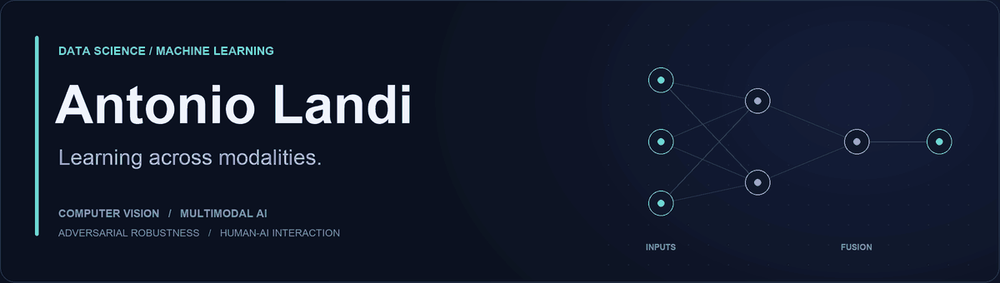

<!--
Personalizzazione: cerca TODO_REPO_01 ... TODO_REPO_04 e sostituisci ciascun
segnaposto con un link Markdown al repository corrispondente.
Tutte le skill del riferimento sono mantenute; rivedile prima di pubblicare.
Per un banner fermo, sostituisci assets/banner.gif con assets/banner.png.
-->

  

<h1 align="center">Ciao, I'm Antonio 👋</h1>

  <b>MSc student in Data Science &amp; Machine Learning · University of Salerno</b> 
  Exploring how machines see, combine information, and behave under uncertainty.

  <a href="mailto:a.landi128@studenti.unisa.it">Email</a> &nbsp;·&nbsp;
  <a href="https://www.linkedin.com/in/antonio-landi-a26408204/">LinkedIn</a> &nbsp;·&nbsp;
  <a href="https://orcid.org/0009-0002-8315-5018">ORCID</a>

## A little about me

I'm a Computer Science graduate working at the intersection of **deep learning, computer vision, and multimodal AI**. I enjoy following an idea through the whole process: understanding the problem, building a model, and testing where it succeeds and where it fails.

My research experience includes adversarial attacks against deepfake detectors with **FakeBusters UNISA**. I'm also interested in **Human-AI interaction**: how intelligent systems can be useful, understandable, and designed around the people who use them.

- 🎓 **University of Salerno** — BSc in Computer Science; currently pursuing my MSc in Data Science and Machine Learning.
- 🛠️ **MioGarage** — front-end development internship with Flutter and Dart, focused on responsive interfaces and usability.
- 🌍 **Erasmus+ at Babeș-Bolyai University**, Cluj-Napoca — studying Computer Science in an international environment.
- 📚 Away from the keyboard: reading, the gym, and an interest in nutrition.

## Research & recognition

| Recognition | Contribution |
| :--- | :--- |
| 🥇 **AADD-2026 Grand Challenge · ACM Multimedia** | Member of **FakeBusters UNISA**, the first-place team working on adversarial robustness of deepfake detectors. |
| 🥈 **Google Challenge Campania · 2026** | Team leader for **Aura — the immortality of ideas**, a multidisciplinary project using generative AI. |

## Publications

### Manifold-Guided Adversarial Attack of Deepfake Detectors via Dual-Branch Autoencoder Projection

*Proceedings of the 34th ACM International Conference on Multimedia (ACM MM '26)*, 2026 · **Published**

Stefano Cirillo, Luigi Di Biasi, Giuseppe Genito, **Antonio Landi**, Mattia Maucioni, Dorotea Serrelli, Giandomenico Solimando.

[Read on ACM Digital Library ↗](https://dl.acm.org/doi/10.1145/3767308.3837703) · [DOI: 10.1145/3767308.3837703](https://doi.org/10.1145/3767308.3837703)

### Auditable Selective Multimodal Fusion under Incomplete Information: Matched-Null Evaluation of Cross-Media Evidence and Time-Series Signals

*Multimedia (MDPI)*, 2026 · **Under review**

Gerardo Iovane, **Antonio Landi**, Mattia Maucioni, Antonio De Rosa, Alessio Rosati, Carmine Ziccardi.

## Technical toolkit

**AI / ML / Data Science**  

**Programming Languages**  

**Web Technologies**  

**Databases**  

**DevOps & Tools**  

**IDEs**  

**Operating Systems**  

**Design & Other**  

## Let's connect

I'd be happy to exchange ideas about **computer vision, multimodal learning, adversarial robustness, and Human-AI interaction**.

Reach me at **[a.landi128@studenti.unisa.it](mailto:a.landi128@studenti.unisa.it)** or connect on **[LinkedIn](https://www.linkedin.com/in/antonio-landi-a26408204/)**.

---

  <i>“Stay hungry, stay foolish.”</i> 
  Steve Jobs

